# MANUAL TÉCNICO DE FUNCIONAMIENTO INTEGRAL
# SISTEMA DE MONITOREO DE CÁMARAS IP – ESTADOCÁMARAS

**Organización:** LosMatus  
**Sistema:** EstadoCámaras  
**Tipo:** Sistema de monitoreo de infraestructura de videovigilancia  
**Backend:** Java 17 – Spring Boot 4.1.0  
**Base de datos:** MySQL  
**Frontend:** React 19  
**Integración de alertas:** WhatsApp Cloud API (Meta)  
**Versión del documento:** 1.0

---

# 1. INTRODUCCIÓN AL FUNCIONAMIENTO DEL SISTEMA

## 1.1. ¿Qué es EstadoCámaras?

EstadoCámaras es un sistema de monitoreo de cámaras IP que permite supervisar automáticamente la disponibilidad y conectividad de los dispositivos de videovigilancia de una organización.

El sistema se instala y ejecuta en un servidor local de la empresa. Desde este servidor, la aplicación realiza verificaciones periódicas hacia las direcciones IP de las cámaras registradas.

Su funcionamiento no requiere que un usuario ingrese constantemente al sistema. Una vez iniciado el backend, este ejecuta automáticamente un proceso de monitoreo en segundo plano.

Cuando se detecta una situación importante, como la desconexión de una cámara o una modificación inesperada de su dirección MAC, el sistema actualiza su estado, registra el evento y puede enviar una notificación a los técnicos responsables mediante WhatsApp.

## 1.2. ¿Qué problema resuelve?

En una infraestructura de videovigilancia pueden existir numerosas cámaras distribuidas en diferentes espacios de una empresa.

Cuando una cámara deja de funcionar, el personal responsable podría no darse cuenta inmediatamente. Esto genera un problema porque una zona puede quedarse sin vigilancia sin que los responsables tengan conocimiento de ello.

EstadoCámaras busca solucionar este problema mediante la supervisión automática.

En lugar de depender de que una persona revise manualmente cada cámara, el sistema realiza comprobaciones periódicas y comunica las situaciones que requieren atención.

## 1.3. Funcionamiento general

El proceso completo puede resumirse de la siguiente manera:

1. El servidor inicia la aplicación EstadoCámaras.
2. Spring Boot carga la configuración y establece conexión con MySQL.
3. El sistema activa el proceso automático de monitoreo.
4. Se consultan las cámaras registradas en la base de datos.
5. El servidor intenta comunicarse con cada cámara mediante su dirección IP.
6. Se realizan verificaciones de ping, puerto TCP y MAC, según corresponda.
7. Los resultados se analizan para determinar el estado de cada cámara.
8. Se actualiza la información en MySQL.
9. Si se detecta un cambio de estado que requiere notificación, se genera una alerta.
10. El backend envía la información a la API de WhatsApp de Meta.
11. WhatsApp entrega el mensaje al número de cada técnico activo registrado.
12. El técnico recibe la alerta en su teléfono.

Este proceso se repite automáticamente mientras la aplicación permanezca ejecutándose.

---

# 2. INFRAESTRUCTURA DE RED: CÓMO SE COMUNICA EL SISTEMA CON LAS CÁMARAS

Antes de comprender el código, es necesario entender cómo se comunican físicamente los dispositivos dentro de la empresa.

## 2.1. Componentes de la infraestructura

En una instalación convencional de videovigilancia encontramos los siguientes elementos:

### Servidor

Es el equipo donde se encuentra instalado EstadoCámaras.

Su función es ejecutar la aplicación, consultar la base de datos, realizar las verificaciones de conectividad y gestionar las notificaciones.

El servidor necesita estar conectado a la infraestructura de red de la empresa y tener rutas de comunicación hacia las cámaras que debe supervisar.

### Router

Es el dispositivo encargado de interconectar diferentes redes IP.

Por ejemplo, puede permitir que una red de servidores se comunique con otra red donde están instaladas las cámaras.

Sus funciones principales son:

- Enrutar paquetes entre diferentes subredes.
- Conectar redes locales con otras redes.
- Aplicar reglas de firewall o filtrado, dependiendo de su configuración.
- Proporcionar acceso a Internet cuando corresponde.

El router no ejecuta el programa de monitoreo ni determina el estado de las cámaras. Su función es permitir o controlar el tránsito de información entre redes.

### Switch

Es el dispositivo que interconecta equipos dentro de una red local.

Por ejemplo, puede conectar:

- El servidor.
- Las cámaras IP.
- Otros equipos de la empresa.
- El router.

Su función principal es transportar las tramas de red hacia el dispositivo correspondiente utilizando direcciones MAC.

Un switch convencional no determina si una cámara está funcionando correctamente. Simplemente permite la comunicación entre los equipos conectados a él.

### Cámaras IP

Son los dispositivos que se desean monitorear.

Cada cámara tiene una dirección IP que permite identificarla y comunicarse con ella dentro de la red.

También puede tener una dirección MAC, que identifica su interfaz de red, y diferentes puertos para ofrecer servicios, como el acceso al sistema de video.

En EstadoCámaras se registra principalmente:

- Nombre de la cámara.
- Dirección IP.
- Puerto TCP.
- Ubicación.
- Dirección MAC esperada.

## 2.2. Ejemplo de infraestructura

Imaginemos que LosMatus tiene la siguiente infraestructura:

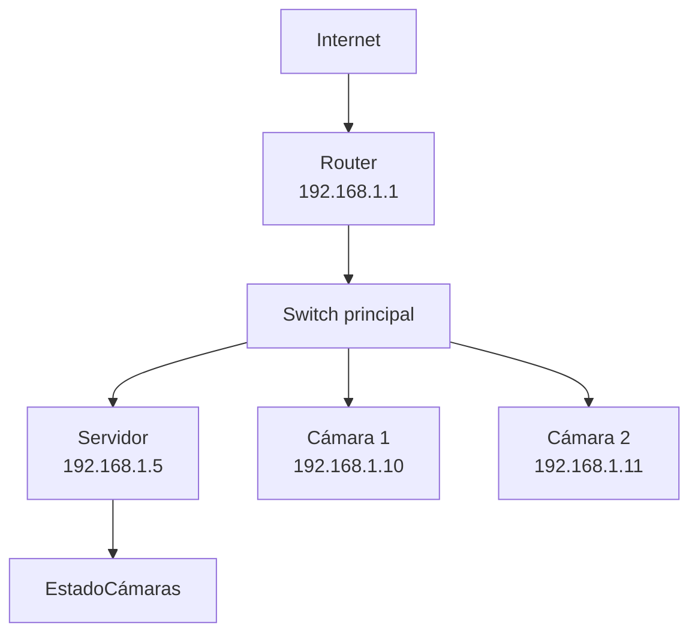

En este ejemplo:

| Dispositivo | Dirección IP |
|---|---|
| Router | 192.168.1.1 |
| Servidor | 192.168.1.5 |
| Cámara 1 | 192.168.1.10 |
| Cámara 2 | 192.168.1.11 |

Las direcciones son ilustrativas.

El servidor y las cámaras están conectados a la misma red local.

Por lo tanto, el servidor puede intentar comunicarse directamente con las cámaras utilizando sus direcciones IP.

## 2.3. ¿Cómo se comunica el servidor con una cámara?

Supongamos que el servidor quiere comprobar la cámara ubicada en:

```text
192.168.1.10
```

El programa utiliza esa dirección IP para generar una solicitud de red.

El sistema operativo del servidor determina cómo debe llegar a esa dirección.

Si la cámara pertenece a la misma subred, el servidor puede comunicarse directamente a través del switch.

Si la cámara pertenece a otra subred, el servidor necesita enviar el tráfico mediante su gateway, normalmente el router.

El recorrido depende de la configuración de red:

**Cuando están en la misma subred:**

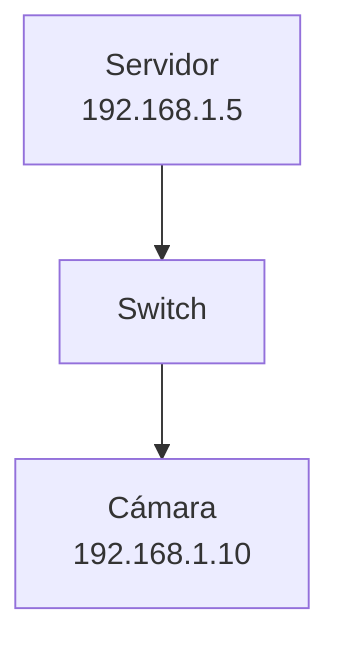

**Cuando están en subredes diferentes:**

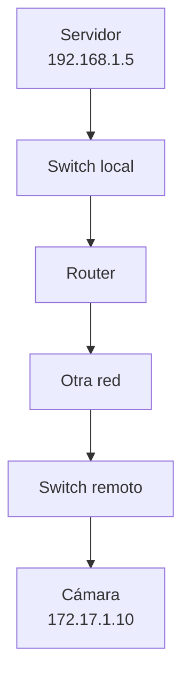

En el segundo caso, el router debe tener una ruta válida y las reglas de seguridad deben permitir la comunicación.

Es importante comprender que EstadoCámaras no configura automáticamente los routers ni los switches. Utiliza la conectividad que ya proporciona la infraestructura de red.

## 2.4. ¿Qué sucede cuando las cámaras están en redes segmentadas?

Una empresa puede tener diferentes redes para separar sus dispositivos.

Por ejemplo:

```text
RED ADMINISTRATIVA
192.168.1.x

RED DE SERVIDORES
172.16.8.x

RED DE VIDEOVIGILANCIA
172.17.1.x
```

Esto significa que los dispositivos no necesariamente están conectados al mismo segmento de red.

Para que EstadoCámaras pueda monitorear una cámara ubicada en otra red, deben cumplirse estas condiciones:

1. El servidor debe conocer una ruta hacia la red de la cámara.
2. El router debe permitir el tránsito entre ambas redes.
3. El firewall debe permitir los protocolos y puertos necesarios.
4. La cámara debe responder a las solicitudes correspondientes.

Por ejemplo, si el servidor está en `172.16.8.x` y una cámara está en `172.17.1.x`, no significa que la comunicación sea imposible.

Significa que debe existir conectividad enrutada entre ambas redes.

**Consideración importante sobre MAC:**

Cuando dos dispositivos están en redes diferentes y se comunican mediante un router, el servidor normalmente no conoce la dirección MAC real de la cámara.

En su lugar, conoce la dirección MAC del siguiente salto de red, que generalmente es el router.

Por eso, la verificación de MAC implementada en EstadoCámaras tiene una limitación: ARP permite identificar directamente la MAC de la cámara cuando esta se encuentra en el mismo segmento de capa 2 que el servidor.

---

# 3. INICIO Y OPERACIÓN DEL PROGRAMA EN EL SERVIDOR

## 3.1. ¿Qué sucede cuando se enciende el servidor?

Cuando se inicia el equipo donde está instalado EstadoCámaras, el sistema operativo carga sus servicios y posteriormente se inicia la aplicación Java.

La aplicación se ejecuta mediante:

```bash
java -jar estadoCamaras-0.0.1-SNAPSHOT.jar
```

En una instalación permanente, este comando puede ejecutarse mediante un servicio de Windows o un mecanismo de inicio automático.

Una vez ejecutado, comienza el ciclo de inicialización de Spring Boot.

## 3.2. Inicialización de Spring Boot

La clase principal es:

```java
EstadoCamarasApplication.java
```

Su contenido incluye:

```java
@SpringBootApplication
@EnableScheduling
public class EstadoCamarasApplication {

    public static void main(String[] args) {
        SpringApplication.run(
            EstadoCamarasApplication.class,
            args
        );
    }
}
```

Esta clase inicia la aplicación.

Durante el arranque ocurren los siguientes procesos:

**1. Carga de configuración**

Spring Boot lee:

- `application.properties`.
- Variables de entorno.
- Archivo `.env`, cuando está disponible.

Entre las configuraciones se encuentran las credenciales de MySQL, la clave JWT y las credenciales de los servicios de notificación.

**2. Creación de componentes**

Spring identifica las clases anotadas con `@Component`, `@Service`, `@Repository` y otras anotaciones de configuración.

Por ejemplo:

- `MonitoreoService`.
- `PingVerificador`.
- `TcpVerificador`.
- `MacResolver`.
- `WhatsappNotificador`.

Spring administra sus instancias y sus dependencias.

**3. Conexión con MySQL**

Se establece la conexión con la base de datos.

Hibernate administra la persistencia de las entidades.

**4. Configuración de seguridad**

Se configuran Spring Security, JWT y las reglas de acceso a la API.

**5. Inicio del servidor web**

Spring Boot levanta el servidor HTTP integrado, que utiliza el puerto 8080 por defecto.

**6. Activación del Scheduler**

La anotación `@EnableScheduling` habilita la ejecución de tareas programadas.

Esto permite que el monitoreo funcione automáticamente sin que un usuario tenga que solicitarlo desde el frontend.

## 3.3. Inicio del monitoreo automático

La clase responsable es:

```text
MonitoreoScheduler.java
```

Su configuración es:

```java
@Scheduled(
    fixedDelay = 60000,
    initialDelay = 5000
)
public void ejecutar() {
    monitoreoService.monitorearTodas();
}
```

Esto establece dos tiempos:

- `initialDelay = 5000`: espera aproximadamente cinco segundos después del inicio de la aplicación para realizar la primera ejecución.
- `fixedDelay = 60000`: espera 60 segundos después de finalizar una ejecución antes de iniciar la siguiente.

Por ejemplo:

```text
SEGUNDO 0
Aplicación iniciada.

SEGUNDO 5
Primera ejecución del monitoreo.

SEGUNDO 10
Finaliza la primera ejecución.

SEGUNDO 70
Comienza la siguiente ejecución.

SEGUNDO 75
Finaliza la segunda ejecución.

SEGUNDO 135
Comienza la siguiente ejecución.
```

Los tiempos de finalización son ilustrativos.

El intervalo de 60 segundos se cuenta desde el final de la ejecución anterior, no desde el comienzo.

## 3.4. ¿Cómo obtiene el programa las cámaras que debe monitorear?

El Scheduler llama a:

```java
monitoreoService.monitorearTodas();
```

Dentro de `MonitoreoService` se utiliza:

```java
camaraRepository.findAllByEliminadaFalse();
```

Esta consulta obtiene todas las cámaras que no han sido retiradas.

Por ejemplo, la base de datos puede contener:

| ID | Nombre | IP | Estado |
|---|---|---|---|
| 1 | Entrada principal | 192.168.1.10 | ACTIVA |
| 2 | Recepción | 192.168.1.11 | ACTIVA |
| 3 | Almacén | 192.168.1.12 | INACTIVA |

El sistema obtiene estos registros y comienza a verificarlos individualmente.

Las cámaras retiradas no participan en el monitoreo automático.

---

# 4. PROCESO DE VERIFICACIÓN DE UNA CÁMARA

Esta sección explica el funcionamiento central del programa.

## 4.1. ¿El programa recibe información de la cámara o la consulta?

EstadoCámaras utiliza un mecanismo de monitoreo activo.

Esto significa que el servidor inicia las comunicaciones hacia las cámaras para comprobar su disponibilidad.

No necesita que la cámara envíe periódicamente su estado al servidor.

Por ejemplo:

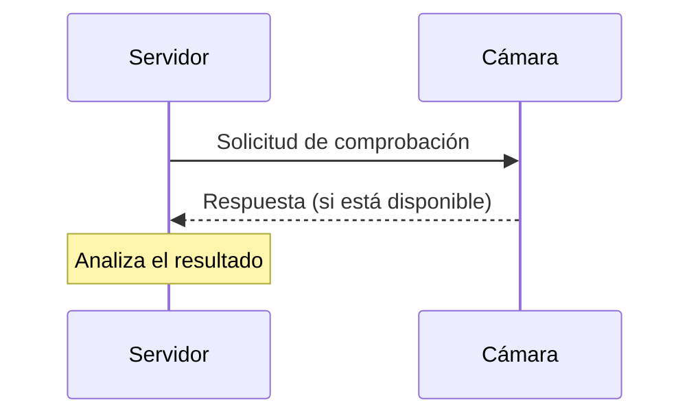

Si el servidor no recibe una respuesta dentro del tiempo esperado, registra el resultado como fallido.

Esto es importante: el sistema determina el estado a partir de las respuestas de red que consigue obtener.

No está leyendo directamente un indicador interno de encendido o apagado de la cámara.

## 4.2. Primera verificación: PING

La primera comprobación se realiza mediante el protocolo ICMP utilizando el comando nativo `ping`.

La clase responsable es:

```text
PingVerificador.java
```

### ¿Qué es ping?

Ping es una herramienta de diagnóstico de redes que permite comprobar si un dispositivo responde a solicitudes ICMP Echo Request.

Cuando el servidor ejecuta ping contra una cámara, envía un paquete de solicitud.

Si el dispositivo está disponible y permite responder a ICMP, devuelve un paquete ICMP Echo Reply.

### Ejemplo

El servidor quiere comprobar:

```text
192.168.1.10
```

Ejecuta:

```bash
ping -n 1 -w 2000 192.168.1.10
```

En Windows:

- `-n 1`: envía un paquete.
- `-w 2000`: espera hasta 2000 milisegundos.

En Linux utiliza:

```bash
ping -c 1 -W 2 192.168.1.10
```

### ¿Qué sucede internamente?

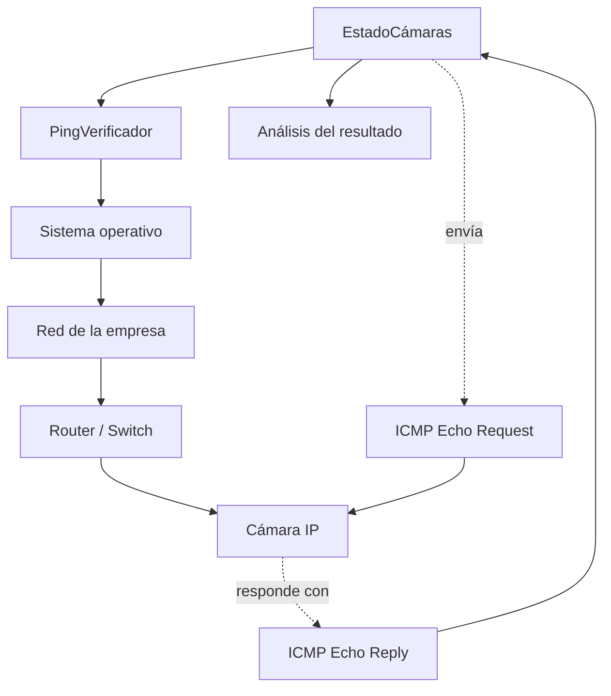

Si la cámara responde, el programa considera que existe conectividad mediante ping.

Si no responde, se registra un resultado negativo.

### ¿Cómo interpreta el resultado Java?

El programa espera la finalización del proceso nativo.

El tiempo máximo de espera del proceso es aproximadamente cuatro segundos, considerando el límite de dos segundos del comando y el margen de espera de Java.

En Windows comprueba que la salida contenga `ttl=`.

Esto evita considerar satisfactoria una respuesta que indique que el host es inaccesible, aunque el comando devuelva un código de salida cero.

El resultado se representa mediante:

```java
ResultadoCheck
```

Ejemplo de resultado satisfactorio:

```java
ResultadoCheck.ok("Ping respondió");
```

Ejemplo de resultado negativo:

```java
ResultadoCheck.fallo("Ping sin respuesta");
```

### ¿Qué significa que ping falle?

No necesariamente significa que la cámara esté apagada.

Puede ocurrir que:

- La cámara esté desconectada.
- El cable de red esté dañado.
- El switch esté apagado.
- El router no tenga una ruta hacia la cámara.
- Exista una regla de firewall que bloquee ICMP.
- La cámara esté configurada para no responder a ping.

Por eso, el sistema no utiliza únicamente ping para determinar el estado final.

---

## 4.3. Segunda verificación: PUERTO TCP

La segunda comprobación permite determinar si un servicio de la cámara está aceptando conexiones en un puerto específico.

La clase responsable es:

```text
TcpVerificador.java
```

### ¿Qué es un puerto?

Una dirección IP identifica un dispositivo dentro de una red.

Un puerto identifica un punto de comunicación asociado a un servicio dentro de ese dispositivo.

Por ejemplo:

```text
IP:      192.168.1.10
PUERTO:  554
```

El puerto 554 se utiliza habitualmente para RTSP, aunque el puerto concreto depende de la configuración del equipo.

### ¿Cómo funciona la comprobación?

El programa utiliza la clase `Socket` de Java.

Ejemplo del código:

```java
socket.connect(
    new InetSocketAddress(
        camara.getIp(),
        camara.getPuerto()
    ),
    timeoutMs
);
```

El timeout predeterminado es de 2000 milisegundos.

Cuando Java intenta conectarse, se produce el establecimiento de una conexión TCP.

De forma simplificada:

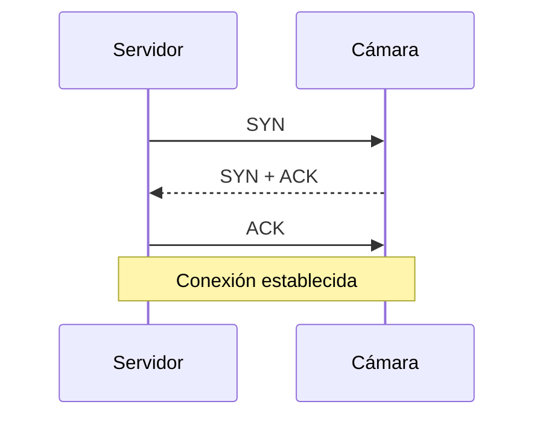

Este procedimiento se conoce como TCP Three-Way Handshake.

Si la conexión se establece, significa que el puerto acepta conexiones TCP.

El programa registra:

```java
ResultadoCheck.ok(
    "Puerto " + camara.getPuerto() + " abierto"
);
```

Si se produce un timeout:

```java
ResultadoCheck.fallo(
    "Puerto " + camara.getPuerto() + ": timeout"
);
```

Si se rechaza la conexión o no existe una ruta:

```java
ResultadoCheck.fallo(
    "Puerto " + camara.getPuerto()
    + ": conexión rechazada o sin ruta"
);
```

### ¿Qué información proporciona esta prueba?

Permite comprobar que el dispositivo o servicio correspondiente está aceptando conexiones TCP en ese puerto.

No comprueba que la imagen de la cámara se esté transmitiendo correctamente.

Por ejemplo, una cámara puede aceptar conexiones en el puerto 554, pero tener problemas en su transmisión de video.

Por tanto, esta prueba verifica disponibilidad TCP, no la calidad ni el contenido del video.

---

## 4.4. Tercera verificación: DIRECCIÓN MAC

La tercera comprobación consiste en obtener la dirección MAC asociada a la IP de la cámara y compararla con la dirección que fue registrada previamente.

Las clases responsables son:

```text
MacResolver.java
MacVerificador.java
```

### ¿Qué es una dirección MAC?

La dirección MAC es un identificador asociado a una interfaz de red.

Ejemplo:

```text
AA:BB:CC:DD:EE:FF
```

Mientras que la dirección IP permite identificar un dispositivo a nivel de red, la dirección MAC se utiliza para la comunicación dentro de una red local Ethernet.

### ¿Cómo obtiene el servidor la MAC?

Para entenderlo hay que conocer el protocolo ARP.

ARP significa Address Resolution Protocol.

Su función es relacionar una dirección IPv4 con una dirección MAC dentro de una red local.

Por ejemplo, el servidor necesita comunicarse con:

```text
IP: 192.168.1.10
```

Si está en la misma subred y no conoce su dirección MAC, el sistema operativo puede enviar una solicitud ARP:

```text
¿QUIÉN TIENE LA IP 192.168.1.10?
```

La cámara responde indicando su dirección MAC.

El servidor guarda esa asociación en su tabla ARP.

Ejemplo:

| Dirección IP | Dirección MAC |
|---|---|
| 192.168.1.10 | AA:BB:CC:DD:EE:FF |
| 192.168.1.11 | 11:22:33:44:55:66 |

### ¿Qué hace EstadoCámaras?

La clase `MacResolver` consulta la tabla ARP del sistema operativo.

En Linux, utiliza:

```text
/proc/net/arp
```

En Windows, ejecuta:

```bash
arp -a 192.168.1.10
```

Busca la dirección MAC correspondiente a la IP solicitada y la normaliza.

Por ejemplo:

```text
aa-bb-cc-dd-ee-ff
```

Se convierte en:

```text
AA:BB:CC:DD:EE:FF
```

**Importante:** `MacResolver` consulta la tabla ARP; no realiza por sí mismo una comprobación independiente de ping ni un escaneo de toda la red. La consulta MAC se ejecuta después de obtener una respuesta positiva de ping o TCP.

### ¿Cómo sabe si la MAC es correcta?

Cuando se registra una cámara, se puede guardar su MAC esperada.

Por ejemplo:

```text
IP:            192.168.1.10

MAC ESPERADA:
AA:BB:CC:DD:EE:FF
```

Durante el monitoreo se obtiene:

```text
MAC DETECTADA:
AA:BB:CC:DD:EE:FF
```

El sistema compara ambas direcciones.

**Caso 1: coinciden**

```text
MAC esperada:  AA:BB:CC:DD:EE:FF
MAC detectada: AA:BB:CC:DD:EE:FF

RESULTADO: COINCIDE
```

**Caso 2: son diferentes**

```text
MAC esperada:  AA:BB:CC:DD:EE:FF
MAC detectada: 11:22:33:44:55:66

RESULTADO: NO COINCIDE
```

En el segundo caso, el sistema considera que existe una alerta porque la dirección MAC detectada no corresponde con la registrada.

Esto puede indicar una sustitución del dispositivo, un cambio de interfaz o una modificación de la infraestructura. Debe investigarse antes de asumir que existe un acceso no autorizado.

**Caso 3: no se encuentra la MAC**

```text
MAC esperada:  AA:BB:CC:DD:EE:FF
MAC detectada: NO DISPONIBLE

RESULTADO: NO SE PUDO VERIFICAR
```

No encontrar una MAC no significa automáticamente que la cámara esté desconectada ni que exista una MAC diferente.

También puede ocurrir por las limitaciones de ARP o porque la entrada no esté disponible en la tabla.

### Limitación cuando existe un router

Supongamos:

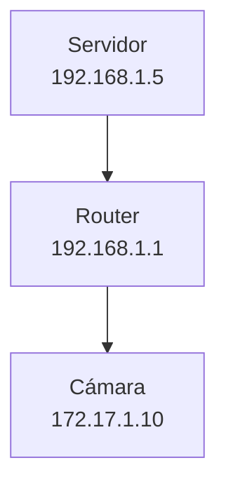

El servidor no puede obtener directamente la MAC de la cámara mediante su tabla ARP.

Cuando envía tráfico hacia otra subred, resuelve la MAC del siguiente salto, que normalmente es el router.

Por eso, si las cámaras están segmentadas en diferentes redes, debe evaluarse cómo se realizará la identificación MAC.

---

# 5. CÓMO EL SISTEMA DETERMINA SI UNA CÁMARA ESTÁ ACTIVA O INACTIVA

## 5.1. El resultado no depende de una sola comprobación

Después de ejecutar las verificaciones, el sistema necesita analizar los resultados.

Esta responsabilidad corresponde a:

```text
EvaluarEstado.java
```

El servicio `MonitoreoService` obtiene los resultados de ping, TCP y MAC y los entrega a esta clase.

La evaluación considera diferentes situaciones.

## 5.2. Estados disponibles

El sistema utiliza cinco estados:

| Estado | Significado |
|---|---|
| ACTIVA | Existe respuesta de conectividad y no se detectó una discrepancia de MAC. |
| INACTIVA | No se obtuvo respuesta ni por ping ni por TCP. |
| DEGRADADA | Ping responde, pero el puerto TCP configurado no acepta conexión. |
| ALERTA | Se detectó una MAC diferente de la MAC esperada. |
| DESCONOCIDO | La cámara todavía no tiene un estado determinado. |

## 5.3. Reglas de evaluación

El código aplica las siguientes condiciones:

### Caso A: cámara inactiva

```text
PING: NO RESPONDE
TCP:  NO RESPONDE
```

Resultado:

```text
INACTIVA
```

El servidor no pudo establecer comunicación mediante ninguno de los dos mecanismos.

### Caso B: cámara degradada

```text
PING: RESPONDE
TCP:  NO RESPONDE
```

Resultado:

```text
DEGRADADA
```

El equipo responde a nivel de red, pero el servicio del puerto configurado no acepta la conexión.

### Caso C: cámara activa

```text
PING: RESPONDE
TCP:  RESPONDE
MAC:  COINCIDE
```

Resultado:

```text
ACTIVA
```

También puede quedar como ACTIVA cuando TCP no está configurado, pero ping responde.

Si ping falla y TCP responde, el sistema también considera que la cámara está ACTIVA, siempre que no exista una discrepancia de MAC.

### Caso D: alerta por MAC

```text
PING: RESPONDE
TCP:  RESPONDE
MAC:  NO COINCIDE
```

Resultado:

```text
ALERTA
```

La conectividad existe, pero la MAC detectada es diferente de la registrada.

La condición de alerta también puede producirse cuando TCP responde aunque ping no lo haga.

## 5.4. Tabla general de decisiones

| Ping | TCP | MAC | Estado |
|---|---|---|---|
| No | No | No consultada | INACTIVA |
| Sí | No | Coincide o no disponible | DEGRADADA |
| Sí | Sí | Coincide o no disponible | ACTIVA |
| No | Sí | Coincide o no disponible | ACTIVA |
| Sí o TCP responde | Disponible y diferente | No coincide | ALERTA |

La comparación MAC solo se realiza si el servidor obtuvo respuesta de ping o TCP.

Cuando no se encuentra una MAC, no se considera una discrepancia confirmada.

## 5.5. ¿Qué sucede si una cámara parece estar desconectada?

El sistema implementa reintentos para evitar declarar una caída definitiva por una interrupción momentánea.

En `MonitoreoService.java` se encuentra:

```java
private static final int REINTENTOS = 3;

private static final long ESPERA_REINTENTO_MS = 3000;
```

El procedimiento es:

1. Se realiza una primera verificación.
2. Si el resultado es INACTIVA y anteriormente tenía otro estado, el sistema espera tres segundos.
3. Realiza otra verificación.
4. Si sigue INACTIVA, vuelve a esperar tres segundos.
5. Repite hasta completar los tres reintentos adicionales.

Por tanto, se realiza una comprobación inicial y pueden realizarse hasta tres comprobaciones adicionales.

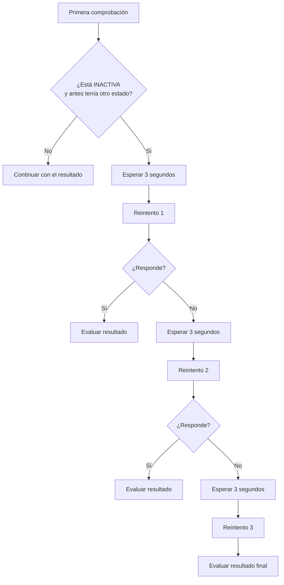

Si continúa sin responder después de los reintentos, se confirma el estado INACTIVA.

Esta lógica se aplica cuando la cámara parece pasar a INACTIVA desde un estado diferente. Si ya estaba INACTIVA, no se vuelven a realizar esos reintentos adicionales en cada ciclo.

---

# 6. ACTUALIZACIÓN DE INFORMACIÓN Y REGISTRO DEL HISTORIAL

Una vez que el sistema determina el estado final, debe almacenar los resultados.

## 6.1. Actualización de la cámara

El servicio utiliza la entidad `Camara`.

Entre los datos actualizados se encuentran:

- Estado actual.
- Última fecha de verificación.
- Última MAC detectada, cuando se obtiene.
- Cantidad de fallos consecutivos.

Ejemplo:

```text
ID: 1
Nombre: Cámara entrada
IP: 192.168.1.10
Puerto: 554

Estado anterior: ACTIVA
Estado nuevo: INACTIVA

Última verificación:
2026-11-27 10:30:00
```

La información se persiste mediante:

```java
camaraRepository.save(camara);
```

## 6.2. Registro del historial

No todas las comprobaciones generan un nuevo registro de historial.

El sistema compara el estado anterior con el nuevo.

Por ejemplo:

```text
VERIFICACIÓN 1: ACTIVA
VERIFICACIÓN 2: ACTIVA
VERIFICACIÓN 3: ACTIVA
VERIFICACIÓN 4: INACTIVA
```

Se registra el cambio:

```text
ACTIVA → INACTIVA
```

Los resultados posteriores que mantengan la cámara INACTIVA no generan un nuevo evento de cambio de estado.

La entidad responsable es:

```text
HistorialEstado.java
```

Al producirse un cambio, se registra:

- Cámara relacionada.
- Estado anterior.
- Estado nuevo.
- Tipo de evento.
- Motivo.
- Fecha y hora.

Los tipos de evento son:

```java
CAMBIO_ESTADO
ALERTA_MAC
```

Ejemplo de historial:

| Fecha | Estado anterior | Estado nuevo | Motivo |
|---|---|---|---|
| 10:00 | DESCONOCIDO | ACTIVA | Ping respondió. |
| 10:30 | ACTIVA | INACTIVA | Sin respuesta. |
| 10:35 | INACTIVA | ACTIVA | Ping y TCP respondieron. |

Este historial permite conocer cuándo se produjo una interrupción y cuándo se recuperó el dispositivo.

---

# 7. SISTEMA DE NOTIFICACIONES: COMUNICACIÓN CON WHATSAPP

Esta parte explica cómo el programa comunica los resultados a los técnicos.

## 7.1. ¿Cómo sabe el sistema cuándo debe enviar una alerta?

El programa no envía un mensaje por cada verificación.

Esto es importante para evitar generar decenas o cientos de notificaciones innecesarias.

En `MonitoreoService.java` existe una condición que determina cuándo se debe notificar.

Se consideran principalmente los cambios relacionados con:

- INACTIVA.
- ALERTA.

Se envía una notificación cuando la cámara entra o sale de alguno de esos estados.

También existe una condición especial para la primera verificación de cada cámara después del arranque del backend.

Por ejemplo:

**Situación 1: cámara activa que se desconecta**

```text
ACTIVA → INACTIVA
```

Se genera una notificación.

**Situación 2: cámara que vuelve a funcionar**

```text
INACTIVA → ACTIVA
```

Se genera una notificación de recuperación.

**Situación 3: cambio de MAC**

```text
ACTIVA → ALERTA
```

Se genera una notificación.

**Situación 4: cámara que sigue inactiva**

```text
INACTIVA → INACTIVA
```

No se envía otra notificación en cada ciclo.

**Situación 5: cambio entre ACTIVA y DEGRADADA**

```text
ACTIVA → DEGRADADA
```

No genera una notificación por sí solo.

## 7.2. ¿Cómo se comunica Java con WhatsApp?

EstadoCámaras no se conecta directamente al teléfono del técnico.

Tampoco envía mensajes mediante WhatsApp Web.

La comunicación se realiza mediante la API oficial de WhatsApp Business Platform, conocida como WhatsApp Cloud API, proporcionada por Meta.

La arquitectura es:

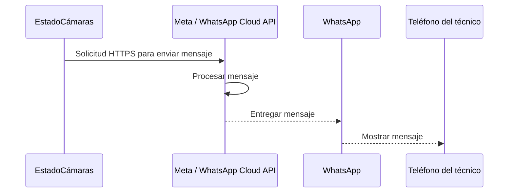

## 7.3. ¿Qué es una API y por qué se utiliza?

Una API permite que dos sistemas diferentes intercambien información.

En este caso:

- EstadoCámaras está desarrollado en Java.
- WhatsApp Cloud API pertenece a Meta.

Java utiliza una solicitud HTTP para pedirle a Meta que envíe un mensaje a un número de WhatsApp.

La aplicación no necesita conocer cómo funciona internamente WhatsApp ni cómo se entrega el mensaje dentro de su infraestructura.

Solamente necesita cumplir el contrato de comunicación establecido por Meta.

## 7.4. Configuración necesaria para WhatsApp

El proyecto utiliza las siguientes variables:

```dotenv
NOTIFICACIONES_CANAL=whatsapp

WHATSAPP_TOKEN=TOKEN_DE_ACCESO

WHATSAPP_PHONE_NUMBER_ID=ID_DEL_NUMERO
```

Cada una cumple una función diferente.

**WHATSAPP_TOKEN**

Es el token de acceso que permite autenticar las solicitudes realizadas a la API de Meta.

Permite demostrar que la aplicación tiene autorización para utilizar el recurso correspondiente.

**WHATSAPP_PHONE_NUMBER_ID**

Es el identificador del número emisor de WhatsApp Business dentro de Meta.

No es el número telefónico del técnico.

**Plantilla de mensaje**

El proyecto utiliza:

```text
alerta_camara
```

Idioma:

```text
es
```

Esta plantilla debe estar creada y aprobada en la plataforma de Meta.

## 7.5. ¿Cómo se prepara el mensaje?

La clase responsable es:

```text
WhatsappNotificador.java
```

Cuando el servicio decide que debe enviar una alerta, invoca:

```java
notificador.notificar(
    camara,
    anterior,
    nuevo,
    motivo
);
```

El notificador de WhatsApp obtiene los técnicos activos:

```java
tecnicoRepository.findByActivoTrue();
```

Esto significa que no envía mensajes a todos los registros indiscriminadamente.

Solamente considera los técnicos cuyo campo `activo` sea verdadero.

Después prepara los cinco parámetros de la plantilla:

| Parámetro | Información |
|---|---|
| {{1}} | Nombre de la cámara |
| {{2}} | Ubicación |
| {{3}} | Dirección IP |
| {{4}} | Estado actual |
| {{5}} | Motivo |

Ejemplo:

```text
Cámara: Entrada principal

Ubicación: Recepción

IP: 192.168.1.10

Estado: INACTIVA

Motivo: Sin respuesta.
Ping: Ping sin respuesta;
TCP: Puerto 554: timeout.
```

## 7.6. ¿Cómo envía Java la solicitud a Meta?

El proyecto utiliza `RestClient` de Spring para realizar solicitudes HTTP.

La dirección base es:

```text
https://graph.facebook.com
```

La solicitud se realiza mediante:

```text
POST /v25.0/{phone-number-id}/messages
```

El número de versión se obtiene de la configuración del proyecto.

La solicitud utiliza autenticación:

```http
Authorization: Bearer TOKEN
```

Y el contenido se envía en formato JSON.

Un ejemplo simplificado del cuerpo es:

```json
{
  "messaging_product": "whatsapp",
  "to": "51987654321",
  "type": "template",
  "template": {
    "name": "alerta_camara",
    "language": {
      "code": "es"
    },
    "components": [
      {
        "type": "body",
        "parameters": [
          {
            "type": "text",
            "text": "Entrada principal"
          },
          {
            "type": "text",
            "text": "Recepción"
          },
          {
            "type": "text",
            "text": "192.168.1.10"
          },
          {
            "type": "text",
            "text": "INACTIVA"
          },
          {
            "type": "text",
            "text": "Sin respuesta"
          }
        ]
      }
    ]
  }
}
```

El ejemplo muestra la estructura de una solicitud; los valores reales son generados dinámicamente por el sistema.

## 7.7. ¿Cómo sabe WhatsApp a quién enviar el mensaje?

Esta es una de las partes más importantes del proceso.

WhatsApp no conoce las cámaras registradas en EstadoCámaras.

Tampoco sabe qué cámara está activa o inactiva.

Esa información pertenece exclusivamente a la aplicación.

Lo que sucede es lo siguiente:

1. EstadoCámaras detecta un cambio de estado.
2. Consulta MySQL para obtener los técnicos activos.
3. Obtiene el número telefónico de cada técnico.
4. Construye una solicitud individual para cada destinatario.
5. Envía la solicitud a Meta indicando el número de destino.
6. Meta valida la solicitud y procesa el envío.
7. WhatsApp entrega el mensaje al destinatario correspondiente.

Por ejemplo, si existen tres técnicos:

| Técnico | Número | Activo |
|---|---|---|
| Juan | 51911111111 | Sí |
| Pedro | 51922222222 | Sí |
| Luis | 51933333333 | No |

El programa solamente prepara envíos para Juan y Pedro.

Luis no recibe la alerta porque está desactivado.

El número de teléfono es el dato que permite identificar al destinatario.

## 7.8. ¿Cómo se envía a varios técnicos?

El proyecto utiliza:

```java
CompletableFuture
```

y un ejecutor con cinco hilos:

```java
Executors.newFixedThreadPool(5);
```

Esto permite realizar diferentes envíos concurrentemente.

Por ejemplo:

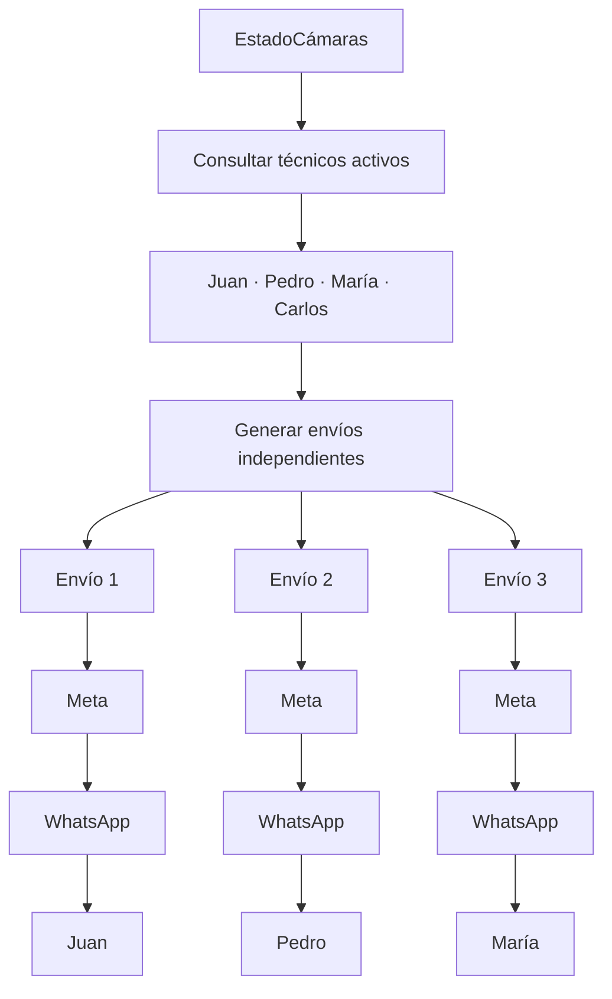

El sistema puede realizar hasta cinco tareas de envío concurrentes mediante ese ejecutor.

Si hay más destinatarios que hilos disponibles, los demás envíos esperan su turno.

Cada envío se maneja de forma independiente.

Si falla el envío a un técnico, se registra el error y se continúa con los demás.

## 7.9. ¿Cómo recibe el técnico el mensaje?

Cuando Meta acepta y procesa la solicitud, WhatsApp se encarga de entregar el mensaje al número de destino.

El técnico recibe la alerta en su aplicación de WhatsApp.

Ejemplo de mensaje:

```text
Se detectó un cambio en el monitoreo
de una cámara.

Cámara: Entrada principal

Ubicación: Recepción

Dirección IP: 192.168.1.10

Estado actual: INACTIVA

Motivo: Sin respuesta. Ping sin respuesta;
TCP: Puerto 554: timeout.

Esta es una notificación automática
del sistema de monitoreo.
Revisa el estado del equipo en el panel.
```

La plantilla se completa utilizando los datos proporcionados por Java.

Meta no calcula el estado de la cámara ni consulta la base de datos de LosMatus.

Solamente recibe los datos y procesa el envío del mensaje.

## 7.10. ¿Qué pasa si WhatsApp no puede enviar el mensaje?

El proyecto utiliza tiempos de espera de cinco segundos para la conexión y lectura de la respuesta HTTP.

Si Meta rechaza la solicitud o se produce un problema de comunicación, el sistema registra el error en los logs.

Por ejemplo:

- Token inválido.
- Permisos insuficientes.
- Plantilla inexistente o no aprobada.
- Número de destino no habilitado.
- Problemas de conexión a Internet.
- Error devuelto por Meta.

La excepción se captura para que un fallo de notificación no interrumpa el monitoreo de las cámaras.

Actualmente no existe un mecanismo implementado de reintentos automáticos de envío ni una cola persistente de mensajes pendientes.

**Importante:** que Meta acepte una solicitud no significa necesariamente que el técnico ya haya leído el mensaje. El proyecto no implementa actualmente un webhook para recibir confirmaciones de entrega o lectura.

---

# 8. PROCESO COMPLETO: EJEMPLO DE UNA CÁMARA QUE SE DESCONECTA

Para comprender cómo trabajan todos los componentes juntos, imaginemos el siguiente escenario.

## 8.1. Situación inicial

La cámara está funcionando correctamente.

```text
Nombre: Entrada principal

IP: 192.168.1.10

Puerto: 554

MAC esperada:
AA:BB:CC:DD:EE:FF

Estado: ACTIVA
```

El servidor tiene acceso a la cámara.

## 8.2. Primera verificación

El Scheduler ejecuta el monitoreo.

El servidor envía ping:

```text
PING → 192.168.1.10
```

La cámara responde.

Después comprueba el puerto:

```text
TCP → 192.168.1.10:554
```

La conexión se establece.

Finalmente, consulta la MAC.

```text
MAC esperada:  AA:BB:CC:DD:EE:FF

MAC detectada: AA:BB:CC:DD:EE:FF
```

Resultado:

```text
ACTIVA
```

Como no hubo cambio de estado, no se registra un nuevo evento ni se envía una notificación.

## 8.3. La cámara se desconecta

Supongamos que se desconecta el cable de red de la cámara.

En la siguiente ejecución, el servidor realiza las comprobaciones.

Ping:

```text
SIN RESPUESTA
```

TCP:

```text
TIMEOUT
```

El sistema detecta una posible caída.

Como la cámara anteriormente estaba ACTIVA, ejecuta los reintentos.

Después de las comprobaciones adicionales, sigue sin responder.

Resultado:

```text
INACTIVA
```

## 8.4. Actualización de MySQL

El sistema modifica el registro de la cámara:

```text
ESTADO ANTERIOR: ACTIVA

ESTADO ACTUAL: INACTIVA
```

También actualiza la última fecha de verificación y el contador de fallos.

Se crea un registro en `historial_estado`.

## 8.5. Generación de la notificación

El servicio comprueba que existe un cambio notificable:

```text
ACTIVA → INACTIVA
```

Por lo tanto, solicita al notificador el envío de una alerta.

El notificador consulta los técnicos activos y obtiene sus teléfonos.

## 8.6. Envío mediante WhatsApp

Java prepara la solicitud HTTPS y la envía a Meta.

Meta procesa el mensaje y lo entrega a los destinatarios correspondientes.

Los técnicos reciben una alerta indicando:

```text
Cámara: Entrada principal

IP: 192.168.1.10

Estado: INACTIVA

Motivo: Sin respuesta.
```

## 8.7. El técnico revisa el problema

El técnico recibe la notificación y puede acudir a revisar:

- Cableado.
- Alimentación eléctrica.
- Switch.
- Puerto de red.
- Cámara.
- Configuración IP.

El sistema no repara automáticamente la cámara. Su función es detectar y comunicar la incidencia.

---

# 9. PROCESO COMPLETO: UNA CÁMARA VUELVE A FUNCIONAR

Ahora imaginemos que el técnico conecta nuevamente el cable de red.

En la siguiente ejecución automática:

1. El Scheduler inicia el monitoreo.
2. Se consulta la cámara.
3. Ping responde correctamente.
4. TCP acepta la conexión.
5. Se verifica la MAC, cuando está disponible.
6. El sistema determina que la cámara está ACTIVA.
7. Se actualiza el registro en MySQL.
8. Se registra el cambio en el historial.

La transición es:

```text
INACTIVA → ACTIVA
```

Como el estado anterior era INACTIVA, el sistema también genera una notificación.

El técnico recibe un mensaje indicando que la cámara volvió a estar disponible.

De esta manera, el personal no solamente conoce las desconexiones, sino también las recuperaciones.

---

# 10. INTERACCIÓN ENTRE EL BACKEND, FRONTEND Y BASE DE DATOS

Aunque el monitoreo funciona automáticamente, el sistema también dispone de una interfaz web para que los usuarios administren y consulten la información.

## 10.1. Backend

Es el componente principal.

Se encarga de:

- Ejecutar el monitoreo.
- Comunicarse con las cámaras.
- Determinar los estados.
- Guardar los resultados.
- Gestionar usuarios y técnicos.
- Enviar las notificaciones.

## 10.2. Frontend

Está desarrollado con React.

Permite:

- Iniciar sesión.
- Consultar el dashboard.
- Ver el estado de las cámaras.
- Registrar cámaras.
- Modificar datos.
- Retirar y restaurar cámaras.
- Consultar el historial.
- Administrar técnicos.

El frontend no realiza las verificaciones de red.

Solamente consulta los datos proporcionados por el backend.

## 10.3. Base de datos

MySQL almacena la información necesaria para el funcionamiento del sistema.

Las principales entidades son:

**Camara**

Almacena la información de los dispositivos y su estado actual.

**HistorialEstado**

Almacena los cambios de estado detectados.

**Tecnico**

Almacena los datos de las personas que pueden recibir notificaciones.

**Usuario**

Almacena las cuentas que pueden acceder al sistema.

## 10.4. Flujo entre los componentes

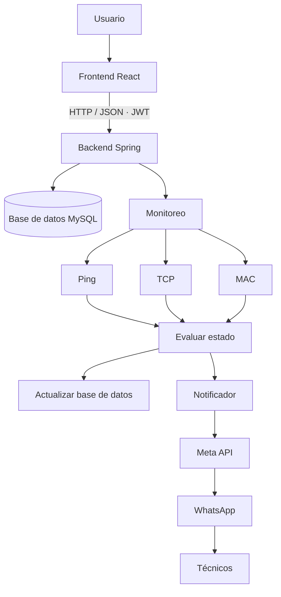

Un aspecto fundamental es que el monitoreo se ejecuta independientemente de las solicitudes del frontend.

Por eso, aunque nadie tenga abierto el dashboard, las cámaras continúan siendo supervisadas mientras el backend esté funcionando.

---

# 11. QUÉ SUCEDE SI OCURREN FALLOS EN LA INFRAESTRUCTURA

Es importante comprender que no todos los problemas de red significan que una cámara esté averiada.

| Situación | Posible resultado |
|---|---|
| Cámara desconectada | Ping y TCP pueden fallar. |
| Cable de red dañado | Ping y TCP pueden fallar. |
| Switch apagado | Varias cámaras pueden quedar inaccesibles. |
| Router sin rutas | Las cámaras de otras subredes pueden quedar inaccesibles. |
| Firewall bloquea ICMP | Ping puede fallar aunque TCP funcione. |
| Puerto cerrado | Ping puede responder y TCP fallar. |
| Cámara en otra subred | Puede responder, pero no será posible obtener directamente su MAC real mediante ARP. |
| Problemas de Internet | El monitoreo local puede continuar, pero las notificaciones externas pueden fallar. |
| MySQL detenido | El backend puede presentar errores de persistencia y no completar correctamente el monitoreo. |
| Backend detenido | No se realizan nuevas verificaciones ni se generan nuevas alertas. |

## 11.1. ¿Qué sucede si se cae Internet?

El monitoreo de cámaras dentro de la red local no necesita necesariamente Internet.

Por ejemplo:

```text
SERVIDOR LOCAL
      |
      v
SWITCH
      |
      v
CÁMARAS IP
```

Esta comunicación puede seguir funcionando aunque la empresa pierda su conexión a Internet, siempre que la red local continúe operativa.

Sin embargo, WhatsApp Cloud API requiere acceso a Internet.

Por lo tanto:

- El monitoreo local puede continuar.
- Los cambios pueden seguir almacenándose en MySQL.
- Los mensajes de WhatsApp no podrán enviarse mientras no exista conexión con Meta.

---

# 12. RESUMEN DEL CICLO COMPLETO DEL SISTEMA

El siguiente diagrama representa el funcionamiento integral de EstadoCámaras desde el momento en que se inicia el servidor.

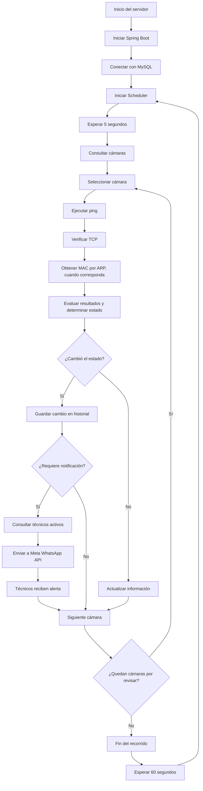

---

# 13. CONSIDERACIONES TÉCNICAS Y LIMITACIONES ACTUALES

Para mantener una comprensión correcta del sistema, el nuevo desarrollador debe conocer las siguientes consideraciones:

1. **El sistema realiza monitoreo activo:** el servidor inicia las comprobaciones. Las cámaras no necesitan enviar su estado al backend.

2. **Ping no garantiza que una cámara esté funcionando correctamente:** solamente permite comprobar si responde a ICMP.

3. **TCP comprueba la disponibilidad de un puerto:** no garantiza que la transmisión de video esté funcionando.

4. **La verificación MAC depende de ARP:** la identificación directa de la MAC real está limitada por la segmentación de red y la disponibilidad de la tabla ARP.

5. **RTSP no está implementado todavía:** actualmente no se realiza una comprobación de transmisión de video.

6. **El monitoreo se ejecuta secuencialmente:** las cámaras se verifican una detrás de otra. Los envíos de WhatsApp sí utilizan procesamiento concurrente.

7. **Las alertas dependen de Internet:** si el backend pierde acceso a Meta, las notificaciones no podrán enviarse.

8. **No existe una cola persistente de notificaciones:** si falla un envío, el error se registra, pero el mensaje no queda guardado automáticamente para reintentarlo después.

9. **El sistema no repara dispositivos:** detecta situaciones, registra información y comunica incidencias al personal responsable.

10. **El backend debe permanecer ejecutándose:** si se detiene la aplicación, el monitoreo automático también se detiene.

---

# 14. CONCLUSIÓN

EstadoCámaras funciona como un sistema centralizado de supervisión de dispositivos de videovigilancia.

El servidor donde está instalado el programa actúa como el centro de control del monitoreo. Desde allí se realizan las comprobaciones de conectividad hacia las cámaras IP registradas, utilizando los mecanismos de comunicación disponibles en la infraestructura de red.

El sistema analiza los resultados de ping, TCP y MAC para determinar el estado de cada dispositivo. Posteriormente, actualiza la información almacenada en MySQL y registra los cambios relevantes.

Cuando se produce una situación que requiere atención, el backend consulta los técnicos activos y utiliza WhatsApp Cloud API para enviar las notificaciones correspondientes.

De esta manera, el proceso conecta cuatro elementos principales:

- **Infraestructura de red:** proporciona la comunicación entre el servidor y las cámaras.
- **Aplicación EstadoCámaras:** realiza las verificaciones y determina los estados.
- **Base de datos MySQL:** almacena los dispositivos, estados, técnicos e historial.
- **WhatsApp Cloud API:** permite comunicar las incidencias a los responsables.

El resultado es un proceso automatizado que permite conocer oportunamente las interrupciones de conectividad de las cámaras y comunicar los eventos al personal encargado de su revisión.

